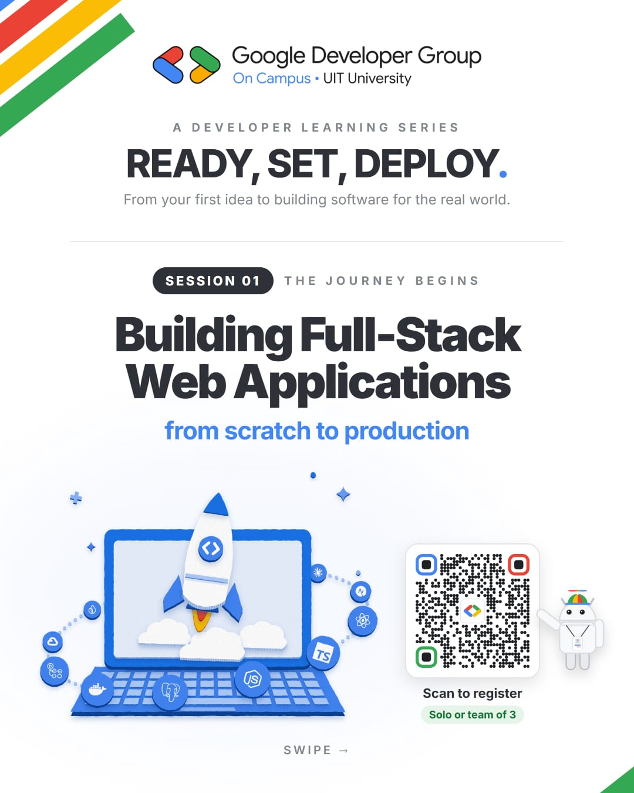
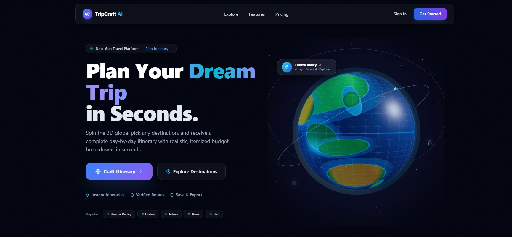
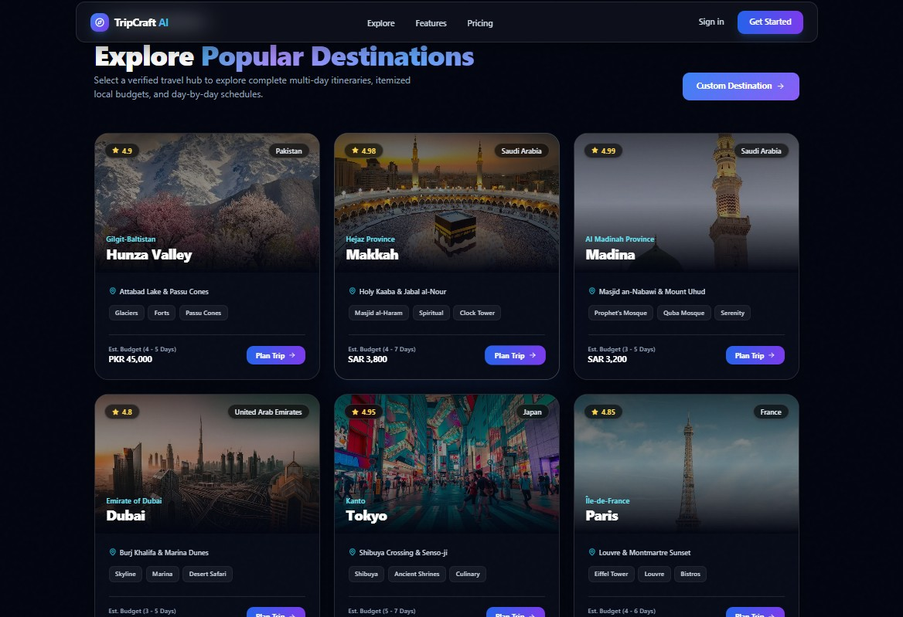

<p align="center">
  
</p>

<p align="center">
  
  
  
  
  
  
</p>

---

## 🚀 The Challenge: GDG "Ready, Set, Deploy"

Built during the **Google Developer Group (GDG) On Campus - UIT University** hackathon. The challenge was to build a full-stack web application from scratch to production. TripCraft AI is our submission—a next-gen travel planning platform.

<p align="center">
  
</p>

---

## ✨ What is TripCraft AI?

Planning a trip usually involves messy spreadsheets, endless browser tabs, and complex budgeting. **TripCraft AI** solves this by generating instant, complete day-by-day itineraries with realistic, itemized budget breakdowns in seconds. 

### Key Features:
* **🌍 Interactive 3D Spatial Globe:** Spin and select destinations directly from an interactive 3D globe built with Three.js.
* **⚡ AI-Powered Itineraries:** Powered by Google's Gemini AI for smart, structured, and realistic travel schedules.
* **📍 Curated Destinations:** Pre-optimized routes for popular hubs like Hunza Valley, Makkah, Madina, Dubai, Tokyo, and Paris.
* **💰 Smart Budgeting:** Accurate, itemized cost breakdowns (Lodging, Food, Travel, Sightseeing) mapped to local currencies (PKR, SAR, EUR, etc.).

---

## 📸 Platform Snapshots

### The Hero Experience (3D Globe)
<p align="center">
  
</p>

### Explore Destinations
<p align="center">
  
</p>

---

## 🛠️ Architecture & Tech Stack

* **Frontend:** Next.js 14 (App Router), React, TypeScript, Tailwind CSS.
* **3D Canvas:** Three.js, React Three Fiber, React Three Drei.
* **Backend API:** Next.js Serverless Functions (Edge-ready).
* **AI Layer:** Google Gemini 1.5 Flash (via `@google/generative-ai`).
* **Schema Validation:** Zod (Strict JSON enforcement).
* **Auth & DB:** Supabase.
* **Deployment:** Vercel.

---

## ⚙️ Quick Setup (Local Development)

To run this project locally:

1. **Clone the repository:**
   ```bash
   git clone https://github.com/DevNahyanK/gdg-tripcraft-ai-team-losers.git
   cd gdg-tripcraft-ai-team-losers
   ```

2. **Install dependencies:**
   ```bash
   npm install
   ```

3. **Set up Environment Variables:**
   Copy the example file and add your `GEMINI_API_KEY` and Supabase credentials.
   ```bash
   cp .env.example .env.local
   ```

4. **Run the Development Server:**
   ```bash
   npm run dev
   ```
   Open [http://localhost:3000](http://localhost:3000) in your browser.

---

<p align="center">
  Built with 💙 by Team Losers for GDG On Campus
</p>